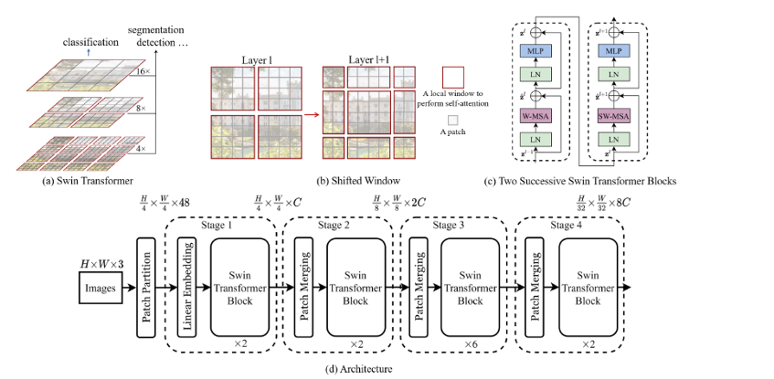
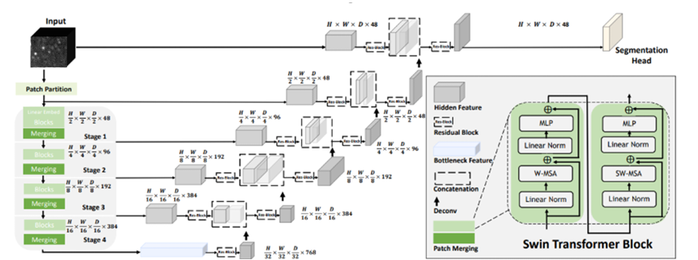
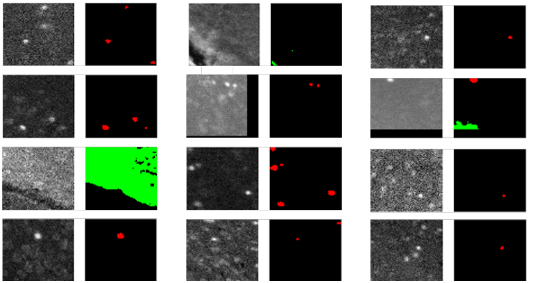
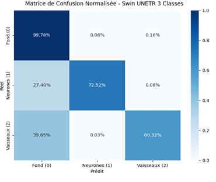
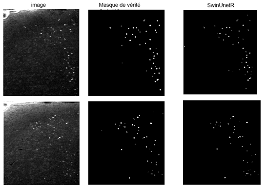

# Automated Detection and Quantification of c-Fos+ Neurons in 3D Mouse Brain Images

## Table of Contents

- [Overview](#overview)
- [Problem Statement and Goal](#problem-statement-and-goal)
- [Data](#data)
- [Methodology](#methodology)
- [Results](#results)

---

## Overview

This project provides a complete, reproducible pipeline for **automatically detecting and quantifying c-Fos+ neurons in 3D mouse brain images**. It uses a **3-class Swin UNETR** segmentation model to distinguish between background, neurons, and undesirable structures (blood vessels and artifacts), followed by a **SimpleITK-based post-processing** step to label and count individual neurons.

The pipeline is designed to handle large volumetric microscopy data and to produce quantitative measurements that are reproducible and operator-independent.

---

## Problem Statement and Goal

The expression of the immediate early gene **c-Fos** is a widely used marker of neuronal activity in neuroscience. Following a stimulus, activated neurons express the c-Fos protein, which appears as bright fluorescent spots in 3D microscopy images. Accurately detecting and counting these c-Fos+ neurons is essential for quantifying brain activation patterns.

However, automated quantification faces three major challenges:

1. **Massive data volume** — each 3D image contains hundreds of millions of voxels.
2. **Confusing structures** — blood vessels and imaging artifacts also appear as bright fluorescent structures, making them difficult to distinguish from neurons.
3. **Reproducibility** — manual counting is time-consuming, operator-dependent, and impractical at scale.

**Goal:** Develop an automated, reproducible pipeline that segments c-Fos+ neurons, distinguishes them from vessels and artifacts, counts individual neurons using morphological post-processing, and exports quantitative statistics.

---

## Data

### 3D Image Characteristics

The data consists of **3D volumetric images** of mouse brain acquired with a **Zeiss Lightsheet 7** microscope.

A 3D image is a volumetric dataset in which each point (voxel) has three spatial coordinates `(x, y, z)` and an intensity value. Unlike 2D images, 3D images capture an entire volume, allowing structures to be analyzed in depth. In light-sheet microscopy, the volume is acquired as a series of optical sections (Z-stacks) that are stacked together.

| Parameter              | Value                                   |
| ---------------------- | --------------------------------------- |
| Microscope             | Zeiss Lightsheet 7                      |
| Image type             | 3D volumetric (Z-stack)                 |
| File format            | CZI (Zeiss proprietary)                 |
| Bit depth              | 16 bits                                 |
| Native resolution (XY) | 1.23 µm × 1.23 µm                       |
| Native resolution (Z)  | 4.68 µm                                 |
| Downsampled resolution | 2.5 µm × 2.5 µm × 4.683 µm              |
| Number of channels     | 2                                       |
| Channel 0              | Autofluorescence (structural reference) |
| Channel 1              | c-Fos (signal of interest)              |

Because the native XY resolution is finer than necessary for detecting c-Fos+ neuron nuclei, the images were downsampled to **2.5 × 2.5 × 4.683 µm** to reduce computational and storage costs.

**Illustration of structure diversity:**

_Figure 1 — Diversity of structures observed in raw 3D images. Neurons, blood vessels, and artifacts can all appear as bright fluorescent structures, making automated detection challenging._

**3D diversity example:**

[▶ Watch the 3D diversity video](docs/videos/example3D.mp4)

_Video 1 — 3D visualization of the diversity of structures present in the raw volumes._

### Undesirable Structures

In raw images, several types of structures are visible:

- **c-Fos+ neurons**: small, round, bright spots (typically 5–15 voxels in diameter).
- **Blood vessels**: elongated, tubular structures with varying intensity.
- **Artifacts**: bright spots caused by tissue autofluorescence, dust, or imaging imperfections.

Because vessels and artifacts share similar intensity levels with neurons, a simple intensity-based threshold cannot reliably separate them. This is the core motivation for a multi-class segmentation approach.

### Why a 3-Class Segmentation Approach?

Instead of treating everything that is bright as a neuron, the model is trained to assign each voxel to one of three classes:

- **Class 0** — Background (dark regions, no signal).
- **Class 1** — Neurons (c-Fos+ cell bodies).
- **Class 2** — Undesirable objects (blood vessels and artifacts).

After prediction, **Class 2 is converted to background**, leaving only neurons. This explicit discrimination prevents vessels and artifacts from being counted as neurons and removes the need for a complex hand-crafted post-processing filter.

---

## Methodology

### The Three Classes

| Class ID | Name                | Description                                         |
| -------- | ------------------- | --------------------------------------------------- |
| 0        | Background          | Low-intensity voxels, no fluorescent signal         |
| 1        | Neurons             | c-Fos+ cell bodies (round, bright, 5–15 voxels)     |
| 2        | Undesirable objects | Blood vessels (elongated) and artifacts (irregular) |

### Swin Transformer Backbone

The Swin Transformer (Liu et al., 2021) is a hierarchical vision transformer that uses **shifted window attention** to model both local and global context efficiently. Unlike standard transformers that compute attention over the entire image, Swin restricts attention to local windows and shifts the window partition between consecutive blocks, enabling cross-window connections.

- **Paper:** [Swin Transformer: Hierarchical Vision Transformer using Shifted Windows](https://arxiv.org/abs/2103.14030)
- **Official code:** [https://github.com/microsoft/Swin-Transformer](https://github.com/microsoft/Swin-Transformer)

_Figure 2 — Swin Transformer architecture with shifted window attention._

### Swin UNETR Architecture

**Swin UNETR** (Hatamizadeh et al., 2021) combines a Swin Transformer encoder with a CNN-based U-Net decoder. The encoder extracts multi-scale features using shifted window attention, while the decoder reconstructs the segmentation map using skip connections from the encoder.

This hybrid design is particularly effective for distinguishing neurons (round shapes) from vessels (elongated shapes), because the transformer's global attention captures shape context beyond local intensity.

- **Paper:** [Swin UNETR: Swin Transformers for Semantic Segmentation of Brain Tumors in MRI Images](https://arxiv.org/abs/2201.01266)
- **Implementation (MONAI):** [https://docs.monai.io/en/stable/networks.html#swinunetr](https://docs.monai.io/en/stable/networks.html#swinunetr)
- **MONAI GitHub:** [https://github.com/Project-MONAI/MONAI](https://github.com/Project-MONAI/MONAI)

_Figure 3 — Global Swin UNETR architecture: Swin Transformer encoder (left) with a CNN-based decoder (right)._

### Training Data

Training is performed on **3D patches of 64 × 64 × 64 voxels**. This size was chosen because neurons measure 5–15 voxels, so a 64³ patch contains several neurons and their surrounding context while remaining computationally tractable.

_Figure 4 — Example of 64 × 64 × 64 voxel patches used for training, with corresponding masks (neurons in red, vessels in green)._

| Split      | Number of patches | Patch size   |
| ---------- | ----------------- | ------------ |
| Training   | 4,945             | 64 × 64 × 64 |
| Validation | 618               | 64 × 64 × 64 |
| Test       | 619               | 64 × 64 × 64 |

Patches containing too much empty background were discarded during dataset construction to reduce class imbalance and training time.

### Post-processing with SimpleITK

After prediction, the 3-class mask is post-processed using **SimpleITK**:

1. **Remove Class 2** — Vessels and artifacts (class 2) are converted to background (class 0).
2. **Binarize** — The mask is converted to a binary neuron mask (class 1 = foreground).
3. **Connected components** — A 26-connectivity labeling assigns a unique ID to each connected object.
4. **Size filtering** — Objects smaller are removed as noise.
5. **Statistics extraction** — For each remaining neuron, the following features are computed: volume, sphericity, elongation, flatness, and bounding-box dimensions.
6. **Export** — Statistics are saved as a CSV file, and the labeled mask is saved as an NRRD image.

This step produces a direct, reproducible neuron count per image.

---

## Results

### Quantitative Results

The Swin UNETR 3-class model was evaluated on the held-out test set (619 patches). The confusion matrix is normalized by true class.

| True class     | Predicted background | Predicted neurons | Predicted vessels |
| -------------- | -------------------- | ----------------- | ----------------- |
| **Background** | **99.78 %**          | 0.06 %            | 0.16 %            |
| **Neurons**    | 27.40 %              | **72.52 %**       | 0.08 %            |
| **Vessels**    | 39.65 %              | 0.03 %            | **60.32 %**       |

**Key observations:**

- **Neurons** are correctly detected in **72.52 %** of cases, with only **0.08 %** misclassified as vessels.
- **Vessels** are correctly detected in **60.32 %** of cases, with only **0.03 %** misclassified as neurons.
- The **background** is perfectly classified (**99.78 %**).
- Most residual errors are voxels of rare classes classified as background, which is acceptable because it avoids false positives in the final neuron count.

### Confusion Matrix

_Figure 5 — Normalized confusion matrix for the Swin UNETR 3-class model on the test set._

### Visual Results

_Figure 6 — Visual comparison between the ground-truth mask and the Swin UNETR prediction. The model correctly identifies neurons while ignoring vessels and artifacts._

---
